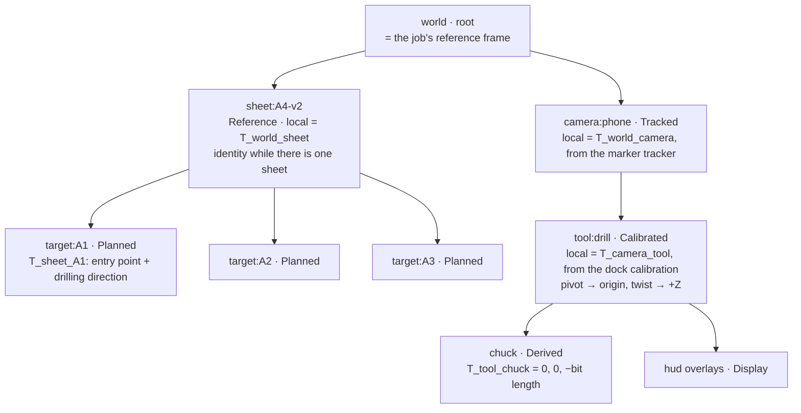

# SmartTools navigation engine: architecture and specification

Status: proposal, v0.1 (2026-11-20). It describes the target architecture. The code at commit `3fe562a` implements
parts of it: the math in `engine/` and a frame-driven pipeline in `lib/navpipeline.ts`.

This document turns a design that already worked in a previous navigation system into a specification for SmartTools.
Its two core ideas are:

1. A **central engine clock**. Every tick checks and updates the state of everything that is navigated. Rendering runs
   as fast as the device allows, and can skip ticks under load.
2. A **scene graph of coordinate frames**. Each element has a position (vector), an orientation (quaternion), a scale
   and an optional parent. Its world transform is recomputed from those values on every tick. Only external modules
   (trackers) write the values.

It then states what we keep, what we refine, and how to get there from the current code.

---

## 1. Goals and non-goals

**Goals**

- One authoritative state of the world per tick, known in real time, independent of how fast the screen refreshes.
- The same engine in the browser (WASM), in a native app and on our own camera module (Rust, no dependencies).
- Deterministic: the same timestamped inputs give the same outputs, bit for bit. This makes testing with the scene
  simulator and replaying field logs possible.
- Safety decisions (the go / no-go gate, depth stop) made by the engine on every tick. The renderer only displays them.
- General geometry. Angled holes, screws and more than one tool or marker sheet should not need new math, only new
  nodes.

**Non-goals (for now)**

- Physics, collision, or a general-purpose game engine.
- Multi-user synchronisation.

---

## 2. Where the current implementation stands

| Concept | Today | Gap |
|---|---|---|
| Clock | None. `NavPipeline.process(frame, t)` runs once per camera frame, inside the same `requestAnimationFrame` that draws the HUD (`components/HudScreen.tsx`). | Tracking rate, state update and rendering are coupled. A slow frame delays all three. There is no prediction to "now". |
| Scene graph | None. The pose is camera←sheet (`Pose { r, t }`, row-major 3×3). The tool is applied on top through `ToolCalib { tip_cam, axis_cam }`. Targets are 2D points on the sheet. | There is no parent/child structure. Holes are assumed perpendicular to the sheet, and there is a single sheet and a single tool. |
| Orientation | 3×3 rotation matrices and Rodrigues vectors. | It works, but there is no canonical quaternion storage and no explicit frame naming. |
| Trackers | Marker detection, robust pose solve and lens undistortion live inside the pipeline that also computes navigation. | The tracker cannot be swapped (for example for a future IMU or our own camera) without touching navigation. |
| Checks | Gate, steadiness and phase logic run per camera frame (`nav::gate`, `Steadiness`, the phase code in `navpipeline.ts`). | They should run per engine tick, with explicit measurement ages. |
| Rendering | Synchronous with tracking. | It should read an immutable snapshot and skip as needed. |
| Testing | `scripts/scene-test.mts` drives the frame pipeline with simulated frames and ground truth. | This carries over: the simulator becomes a tracker and the clock becomes simulated time. |

The math in `engine/` carries over without changes: pose, robust solve, lens, calibration, filter, gate and simulator.
The new parts are the **engine loop**, the **scene graph** and the **measurement interface** around them.

---

## 3. Conventions

These are fixed for every module. Most navigation bugs come from mixing conventions.

- **Units:** metres, radians internally (degrees only at the UI), seconds.
- **Precision:** `f64` for all tracking and navigation math. `f32` only for GPU buffers.
- **Handedness:** right-handed.
- **Transform notation:** `T_A_B` is the pose of frame B expressed in frame A. It maps points from B to A:
  `p_A = T_A_B · p_B`.
  - Composition: `T_A_C = T_A_B · T_B_C`.
  - Inverse: `T_B_A = T_A_B⁻¹`.
  - The current `Pose` (camera←world) is `T_camera_sheet` in this notation.
- **Quaternion:** Hamilton convention, stored as `(w, x, y, z)`, active rotation, unit norm. `q` and `−q` are the same
  rotation. Before averaging, interpolating or filtering, force continuity with the previous value (if `dot < 0`, use
  `−q`).
- **Camera frame:** OpenCV convention (x right, y down, z forward), as today.
- **Tool frame:** origin at the bit tip, +Z is the drilling direction (from the chuck toward the tip).
- **Target frame:** origin at the planned entry point on the surface, +Z is the planned drilling direction (into the
  material). A hole square to the surface has target +Z = −(surface normal).

---

## 4. Scene graph

### 4.1 Transform

```text
Transform {
  position:    Vec3   (m)
  orientation: Quat   (unit)
  scale:       Vec3   (default 1,1,1)
}
```

- **Rigid chains carry no scale.** Every node that takes part in tracking or navigation must keep scale = (1,1,1).
  Scale is allowed only on **display leaves** (a mesh, a label). Non-uniform scale under a rotated child produces shear,
  breaks the rigid-body inverse, and would quietly change measured distances.
- **Composition.** With unit scale on rigid chains, compose the quaternion and the vector directly (§4.3). Build a 4×4
  matrix only for the GPU.

### 4.2 Node

```text
Node {
  id:        NodeId                 (stable, small integer; names are metadata)
  parent:    Option<NodeId>         (None = child of the world root)
  local:     Transform              (T_parent_node) — written only by its owner (a tracker, a calibration, the plan)
  world:     Transform              (T_world_node)  — written only by the engine, every tick
  kind:      Reference | Tracked | Calibrated | Planned | Derived | Display
  status:    Valid | Predicted { age } | Stale { age } | Lost | Uncalibrated
  stamp:     Time                   (capture time of the measurement behind `local`)
  quality:   f64 or covariance      (see §8)
}
```

Invariants:

- **Single writer per field.** Trackers write `local`, `stamp` and `quality` of their own nodes, and only through the
  measurement queue (§6). The engine writes `world` and `status`. Nothing else writes either.
- **The graph is a tree.** A cycle is rejected when a node is added or re-parented.
- **Topological order.** Nodes are kept in an array sorted so that every parent comes before its children (a
  breadth-first order rebuilt on structural changes). The update is a single linear pass, with no recursion.

### 4.3 World update (every tick)

For each node `n` in topological order:

```text
if n.parent is None:  n.world = n.local
else:
  P = world[parent]
  n.world.orientation = normalize(P.orientation ⊗ n.local.orientation)
  n.world.position    = P.position + rotate(P.orientation, P.scale ⊙ n.local.position)
  n.world.scale       = P.scale ⊙ n.local.scale        (display leaves only)
```

The original design recomputes the world transform from position and quaternion on every tick, rather than
accumulating changes. That is the right choice, and it is kept:

- **Gimbal lock** belongs to Euler angles. Quaternions avoid it as long as Euler angles are never stored, only
  displayed.
- **Drift** comes from integrating small increments: multiplying a rotation by a delta tick after tick. Here every
  `local` is an absolute value set by a tracker, and `world` is recomputed from scratch. Nothing accumulates, so a still
  scene stays still to the last bit.
- **Renormalisation.** The quaternion is renormalised when it is written and after composition, which costs a few flops.
  Rotation matrices are derived from it only when needed (projection, GPU), so they never need re-orthogonalising.

**Cost.** Composing one quaternion and vector is about 60 flops. A few hundred nodes take microseconds, so recomputing
everything every tick is cheaper than tracking dirty flags, and simpler. Dirty flags can be added later if the graph
grows to thousands of nodes.

### 4.4 Relative queries

Navigation is always a relation between two nodes:
`T_A_B = world[A]⁻¹ · world[B]`. The engine provides `relative(A, B)`. Every navigation number is computed from it, in
the frame where it means something. For example, the bit tip in the target frame gives offset and depth directly
(§9).

---

## 5. The SmartTools scene



- **Tracked (camera).** The marker tracker measures `T_camera_sheet`. The engine stores the camera's local transform
  as `T_world_camera = T_world_sheet · T_camera_sheet⁻¹` (see measurement edges, §6.2).
- **Calibrated (tool).** `T_camera_tool` comes from the dock calibration:
  - **Position:** the bit tip in the camera frame, from the pivot.
  - **Orientation:** the rotation that takes the tool's +Z to the bit axis measured by the twist. Rotation about the
    bit axis is a free choice: fix it so that the tool's +Y is as close as possible to the camera's −Y.
- **Planned (targets).** A target is a full frame, not a 2D point, so an angled hole needs no special case. The A4 sheet
  marks square holes: target orientation = 180° about X relative to the sheet (+Z into the wall).
- **Later:** more sheets as siblings of `sheet:A4-v2`, a screwdriver as another tool, and a room map as a parent of
  the sheets. These are additions to the tree, not changes to the code.

---

## 6. Trackers and measurements

### 6.1 Measurement

```text
Measurement {
  edge:      (from: NodeId, to: NodeId)     what was observed: T_from_to
  transform: Transform                       rigid, unit scale
  t_capture: Time                            when the light hit the sensor, not when processing ended
  quality:   { markers: u32, rms_px: f64, covariance: Option<[f64; 36]> }
  source:    TrackerId
}
```

- **Timestamps are capture times.**
  - In the browser: `requestVideoFrameCallback` metadata (`captureTime`, or `expectedDisplayTime` minus pipeline
    latency).
  - In the simulator: the true frame time.
  - Detection takes 10–40 ms on a phone. With capture timestamps, the engine knows how old a measurement is and can
    compensate (§8).
- **Measurement edges, not absolute poses.** A tracker reports what it saw, `T_camera_sheet`, and does not compute a
  world pose. The engine knows which node owns the edge and turns it into that node's `local`. This keeps trackers
  ignorant of the scene layout. It also makes it possible to change the reference: in surgical navigation, the
  patient's bone reference and not the camera is the root, so the patient moving does not matter.
- **Queue.** Trackers push measurements into a single-producer / single-consumer ring buffer, one per tracker. The
  engine drains the queues at the start of each tick, sorted by `t_capture`. No locks are taken during the tick and no
  state is half-written.

### 6.2 From edge to local

If the measured edge is `(camera, sheet)` and the camera node is the one being tracked:
`local(camera) = T_world_sheet_at(t_capture) · inverse(T_camera_sheet)`, re-expressed relative to the camera's parent.
The engine owns this logic, written once and generic for any edge.

---

## 7. The engine clock

### 7.1 Tick

A fixed period `Δ`. Proposed: **Δ = 1/120 s**, at least the camera rate, so that every measurement is consumed within
8 ms. Engine time is logical: `t_k = t_0 + k·Δ`. Timers only wake the loop; they never define the state time. This is
what makes the engine deterministic.

Every tick, in this order:

1. **Ingest.** Drain the measurement queues, sorted by capture time.
2. **Estimate.** For every tracked node, update its estimator with the new measurements (§8). Then predict to `t_k` and
   write the predicted value into `local`, with status `Valid`, `Predicted { age }` or `Stale`.
3. **Transforms.** Do the world update in topological order (§4.3).
4. **Relations.** For every (tool, target) pair that matters, compute `T_target_tool` and the navigation state (§9).
5. **Checks** (deterministic, fixed order):
   1. measurement age and staleness;
   2. calibration validity;
   3. steadiness windows;
   4. the go / no-go gate;
   5. the phase state machine;
   6. safety limits (depth stop, lost tracking while drilling).

   These produce **events**: entered-target, ready, stop-depth, lost, and so on.
6. **Publish.** Write an immutable **snapshot** (§10): tick number, `t_k`, every node's world transform and status,
   the navigation states, the gate bits, the phase and the events since the previous snapshot.

### 7.2 Load and overruns

- Use an accumulator loop:
  - run ticks until engine time catches up with wall time;
  - at most `N_max` = 4 ticks per wake-up;
  - if behind by more than that, drop the backlog, log an "overrun" event, and move engine time forward (no "spiral of
    death").
- Tick cost is bounded by the number of nodes and pairs, which is small (microseconds). Expensive work stays out of the
  tick: image processing, the pose solve and calibration live in the trackers or in background jobs.
- The engine reports `tick_ms` (p50/p99) and the number of overruns, and the HUD shows a warning if they degrade.

### 7.3 Rendering

- The renderer runs at the display rate (`requestAnimationFrame` or a native vsync). Each time, it takes the **latest**
  snapshot.
- If rendering is slower than the engine, ticks are skipped for display but never for state.
- **Interpolation policy.** Draw the latest snapshot as it is, with no interpolation between ticks.
  - At 120 Hz the visible step is under 8 ms.
  - Interpolating would add up to one tick of latency, and the display would show something the gate never evaluated.
- **The HUD never decides.** Colours, "Ready · drill" and "Stop" come from the gate bits and events in the snapshot.
  Today `lib/hud.ts` still runs a lock timer (`LOCK_TIME`); that moves into the engine's checks.

---

## 8. Estimation per tracked node

- **Filter.** One estimator per tracked node:
  - state: position, velocity, orientation, angular velocity;
  - an error-state Kalman filter on SE(3), or, to start with, the current One Euro filter applied in the node's frame
    plus a finite-difference velocity.
- **Measurement update** at `t_capture`. Out-of-order measurements are rare with one camera. Keep the last 200 ms of
  history so that a late measurement can be inserted and the prediction recomputed.
- **Prediction to `t_k`.** Constant velocity, capped at 50 ms. Beyond that the status becomes `Stale` and the gate
  closes.
  - **Why it matters:** at 50 mm/s and 60 ms of camera-to-screen latency, the drawn tip lags by 3 mm. Prediction
    removes most of that lag. The gate still uses the measurement age, so prediction never turns an old measurement into
    a "ready".
- **Uncertainty.** Keep a covariance (or at least one scalar per node) and propagate it to the tip in the target
  frame.
  - The gate's margin then becomes dynamic: "ready" if the bound `angle + k·σ_angle < 0.5°` holds. Today the margin is
    a fixed 0.4° / 0.75 mm, set from the simulator.
  - Sources of σ: number of markers, RMS reprojection error, distance and incidence angle. Each can be modelled and
    checked in the simulator.

---

## 9. Navigation from relative transforms

With `T = T_target_tool` (tool expressed in the target frame), every number the user sees comes from one transform:

| Quantity | Formula |
|---|---|
| Tip offset in the surface plane | `‖(T.p.x, T.p.y)‖` while the tip is at or above the surface |
| Aim point (where the bit axis meets the target plane) | the bit axis `T.R·ẑ` from `T.p`, intersected with `z = 0` |
| Gap / depth along the planned direction | `−T.p.z` when in front / `T.p.z` when inside |
| Angle error | `acos(ẑ · T.R·ẑ)` (between the tool +Z and the target +Z) |
| Yaw / pitch for the rings | the components of `T.R·ẑ` in target x and y |

These generalise `nav::evaluate_world` (today it assumes the target +Z = −sheet normal) to any target orientation and
to any surface (the sheet, a beam, a bone).

---

## 10. Snapshot (engine → renderer, logger, UI)

```text
Snapshot {
  tick: u64, t: Time,
  nodes:  [ { id, world: Transform, status, age } ],
  pairs:  [ { tool, target, nav: NavState, gate: u32 } ],
  phase, active_target, events: [Event],
  stats:  { tick_ms_p50, tick_ms_p99, overruns, measurement_latency_ms }
}
```

Immutable and double-buffered: the engine writes buffer B while renderers read buffer A, then they swap. In the browser:

- **Preferred:** a `SharedArrayBuffer` (needs cross-origin isolation headers, which a `vercel.ts` config can set).
- **Fallback:** a `postMessage` of a small typed array per tick.

---

## 11. Processes and threads

| Platform | Engine | Trackers | Renderer |
|---|---|---|---|
| Browser (today's target) | Web Worker with the WASM core, accumulator loop | Marker detection in a second worker (`MediaStreamTrackProcessor` / `VideoFrame`, or `OffscreenCanvas`); measurements via `postMessage` | Main thread: `requestAnimationFrame` reads the snapshot |
| Native app (Android) | Dedicated thread, Rust | Camera2 callback thread → JNI → queue | UI thread |
| Own camera module | Rust `no_std` + RTOS task at a fixed rate | ISP / detector task | Phone over BLE/USB, receives snapshots |

The same Rust crate runs everywhere. Only the clock source, the queues and the snapshot transport change.

---

## 12. Logging, replay and testing

- **Log the inputs.** Log measurements, configuration and calibrations with timestamps, not the derived state.
  Replaying the log through the engine gives the same snapshots bit for bit. This is how a field session becomes a
  regression test. Each hole can also become an agentvcs step record: inputs plus the engine version.
- **Property tests (Rust):**
  - composing transforms agrees with 4×4 matrices;
  - `relative(A, B) · relative(B, A) = I`;
  - re-parenting keeps world transforms;
  - a still scene does not drift after 10⁶ ticks;
  - adding a cycle is rejected;
  - `q` and `−q` give the same output.
- **Scene simulator.** It becomes a tracker that produces frames, or directly measurements, with a simulated clock.
  `scripts/scene-test.mts` keeps its 17 checks and adds new ones:
  - latency compensation with a 60 ms camera delay;
  - an overrun storm (ticks skipped, state still correct);
  - out-of-order measurements;
  - an angled-hole target.

---

## 13. Analysis: keep, refine, add

**Keep (the original design is right about these):**

1. A central clock, separate from rendering, with frame skipping under load.
2. A tree of frames with position + quaternion (+ scale), whose world transforms are recomputed from scratch every tick.
   There is no drift and no gimbal lock.
3. Trackers are the only writers of observed state. The engine owns derived state.

**Refine:**

| # | Refinement | Why |
|---|---|---|
| R1 | Logical tick time (`k·Δ`), with timers only used to wake the loop | Determinism and exact replay; tests no longer depend on the machine's speed |
| R2 | Capture timestamps on measurements, and prediction to the tick time | Removes the ~3 mm visual lag at drilling speeds; makes measurement age explicit for the gate |
| R3 | Measurement **edges** (`T_from_to`) instead of trackers writing world poses | Trackers stay independent of the scene layout; allows re-rooting (the workpiece as the reference, as in surgical navigation) |
| R4 | No scale on rigid chains; scale only on display leaves | Avoids shear and keeps distances honest |
| R5 | Compose quaternion + vector directly; matrices only for the GPU | Fewer operations, nothing to re-orthogonalise, the same drift-free property |
| R6 | Topological array instead of recursion | Constant-time, cache-friendly update; cycle detection at insertion |
| R7 | Single-writer rule enforced by API (queues in, snapshot out) | No half-updated state seen by the renderer or the checks |
| R8 | Safety decisions only in the engine; the HUD only displays | The gate, lock time and depth stop are tested once, in Rust, not re-implemented per screen |

**Add:**

| # | Addition | Why |
|---|---|---|
| A1 | Status per node (`Valid`, `Predicted`, `Stale`, `Lost`, `Uncalibrated`) with age | The gate and the UI reason about trust explicitly |
| A2 | Uncertainty propagated to the tip and a dynamic gate margin | Replaces the fixed 0.4° / 0.75 mm margin with one that adapts to how well the markers are seen |
| A3 | Targets as full frames | Angled holes, screws and non-planar surfaces with no new math |
| A4 | Replay logs as regression tests and agentvcs records | Field sessions become tests; changes can be bisected by precision |
| A5 | Engine statistics (tick time, overruns, latency) in the snapshot | Load-dependent skipping is visible and measurable, not silent |

---

## 14. Migration plan

Each phase ends with the scene test passing 17/17 (plus its new checks), so nothing regresses.

1. **Scene graph in Rust** (`engine/src/scene.rs`).
   - `Transform`, `Node`, a topologically ordered tree, `relative()`, and quaternion helpers next to today's matrices.
   - Property tests from §12.
   - Navigation re-expressed as `T_target_tool` (§9). Results are identical to `nav::evaluate` for square targets, and
     a parity test checks it.
2. **Engine loop** (`engine/src/engine.rs`).
   - Measurement queue, logical clock, the tick steps of §7.1, the snapshot, an FFI
     (`engine_push`, `engine_tick(n)`, `engine_snapshot`).
   - The gate, lock timer, steadiness and phase machine move out of `navpipeline.ts` and `hud.ts` into the engine's
     checks.
3. **Tracker split.**
   - `NavPipeline` becomes `MarkerTracker`: it outputs `Measurement { edge: (camera, sheet), t_capture, quality }`
     only.
   - The simulator drives the engine with a simulated clock. New checks: latency compensation, overruns,
     out-of-order input.
4. **Browser threading.** Engine in a Web Worker, detection in a second worker, HUD on `requestAnimationFrame` reading
   the snapshot. Measure end-to-end latency on a real phone.
5. **Estimation upgrade.** Constant-velocity prediction, covariance propagation, the dynamic gate margin. Validate
   false-ready = 0 under the simulator's worst cases.
6. **Replay.** Log format, a `scene:replay` script, agentvcs step records per hole.

---

## 15. Open questions

- **Tick rate on low-end phones.** Is 120 Hz in a worker realistic, or should Δ adapt (for example 60 Hz) and be
  recorded in the snapshot?
- **Root choice for multi-sheet jobs.** Is it the first sheet seen, or a room map built as sheets are added (SLAM-like
  alignment of marker sheets)?
- **Rotation about the bit axis.** Should the tool frame fix it from the dock geometry (proposed), or leave it free and
  only use the axis?
- **IMU fusion.** Once our own camera module exists, does it carry an IMU? If so, the estimator in §8 already has the
  slot for it (a gyro at 1 kHz between camera frames).
