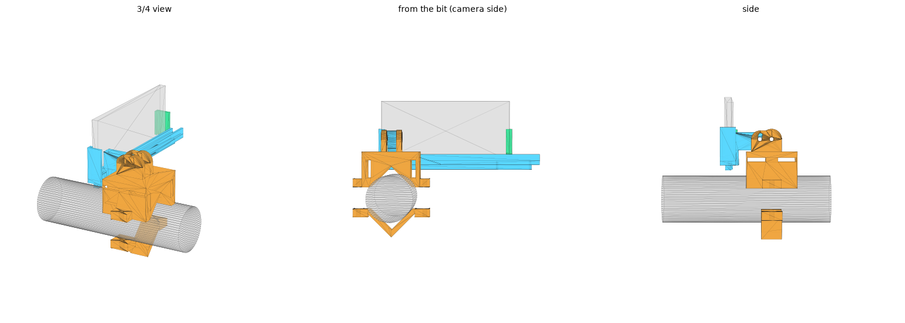

# SmartTools Dock v0.2: universal phone mount for cordless drill/drivers

**English** · [Español](README.es.md)

An adjustable mount that holds a phone on a cordless drill/driver, with the camera facing the bit and the screen
facing the user. Designed for the Ingco CDLI20022 and the Xiaomi Redmi Note 13, but **adjustable** for other models.



| Adjustment | Range |
|---|---|
| Phone length (landscape) | 140–175 mm (sliding jaw + M4 wing nut) |
| Phone thickness | up to 12 mm, slim case included |
| Drill body | approx. Ø 38–68 mm (split clamp: two facing 90° V-blocks, rubber pads and 2 M5 bolts with wing nuts) |
| Camera tilt | ±15° (M5 hinge with an arc slot), to set the camera parallel to the bit |

The stops on the camera side are low (12 mm), so the camera stays clear on any phone model.

## Parts to print (1 of each)

| File | Approx. size | Solid volume | Suggested orientation |
|---|---|---|---|
| `saddle.stl` (upper V-block) | 60 × 94 × 70 mm | 123 cm³ | On its bottom face (V opening toward the bed). The 45° V needs no supports; the strap tunnels do (supports on the bed only) |
| `lower.stl` (lower V jaw) | 24 × 94 × 34 mm | 20 cm³ | V opening up, resting on the ears: no supports |
| `arm.stl` (arm + rail + fixed jaw) | 44 × 196 × 86 mm | 46 cm³ | On its side (flat tongue on the bed). Supports allowed |
| `jaw.stl` (sliding jaw) | 19 × 21 × 40 mm | 3 cm³ | Phone contact face toward the bed |

**Material:** PETG (or ASA/ABS). Do not use PLA: it deforms with motor heat and sunlight.
**Settings:** 0.2 mm layers · 4 perimeters · 5 top and bottom layers · 30–40 % gyroid infill.
**Tolerances:** 0.3 mm clearance per side at the hinge and the jaw. Holes are Ø5.5 for M5 and Ø4.5 for M4.

## Hardware (not printed)

- 2 × M5 × 35 mm bolt + 2 washers + 2 M5 wing nuts (hinge and tilt lock)
- 2 × M5 × 80 mm bolt + 2 flat washers + 2 **lock washers** + 2 M5 wing nuts (clamp). For bodies up to Ø56 mm, M5 × 60 is enough
- 1 × M4 × 16 mm bolt + washer + M4 wing nut (jaw)
- Optional: 1 hook-and-loop strap, 20 mm × 300 mm, as a backup (runs through the saddle tunnels)
- 2 mm self-adhesive rubber or neoprene for **all 4** faces of the two V-blocks (grip and vibration damping)
- Optional: a 2 mm foam strip at the bottom of the rail, for thin phones

## Assembly

1. Stick the rubber on the 4 faces of the two V-blocks.
2. Set the saddle on the motor housing, behind the chuck and in front of the trigger. Put the lower jaw underneath,
   pass the 2 M5 × 80 bolts top-down through the ears and tighten the wing nuts (with lock washers) evenly, a little on
   each side, until the dock neither turns nor slides. Do not overtighten: the housing is plastic.
   Optional: run a strap through one tunnel as a backup.
3. Insert the arm's tongue between the ears: the front M5 is the hinge, the rear one goes through the arc slot (lock).
4. Put the phone in landscape on the rail, screen toward you and camera toward the bit, against the fixed jaw. Slide the
   moving jaw in and tighten the M4 wing nut.
5. Adjust the tilt until the camera is parallel to the bit and tighten the lock wing nut.
6. In the app: print `/markers`, open `/hud` → **Cam**, rest the tip on **A2** and tap **Calibrate**.

## Before printing: measure your drill

I don't have drawings of the Ingco CDLI20022, so the clamp uses two V-blocks that fit a range of diameters (the script
checks Ø38 to Ø68 mm with no collisions between parts). With calipers, check:

- [ ] The motor housing diameter, between the chuck and the trigger, is between 38 and 68 mm.
- [ ] There are at least 60 mm of free length on top for the saddle and 24 mm underneath for the lower jaw, in front of
      the trigger (clear of the torque collar and the LED light).
- [ ] The forward/reverse and speed selectors stay reachable with the saddle in place.

If something doesn't fit, change the parameters in `dock.py` (for example `SAD_X`, `SAD_BOT`, `PHONE_LEN_MAX`) and
regenerate.

## Regenerating the STLs

```bash
python3 -m venv .venv && .venv/bin/pip install manifold3d numpy matplotlib
.venv/bin/python dock.py
```

The script also checks that the parts don't interfere (0° and ±15° tilt, clamp from Ø38 to Ø68 mm), computes the bolt
length needed and writes `preview.png`.

## Known limitations (v0.2)

- **Not physically tested yet.** This is the first iteration: print one and test it before making more.
- The software assumes the camera is parallel to the bit. The tilt lock lets you set this by eye; automatic axis
  calibration is the next step.
- Vibration can loosen wing nuts: use lock washers and check the clamp before each session. In the app, rest the tip on
  A2 to check the calibration: if the dock moved, recalibrate.

## License

Apache License 2.0, like the rest of the repository. See [LICENSE](../../LICENSE).
